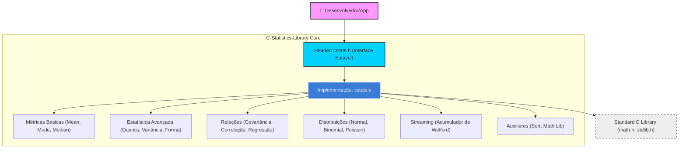

# C-Statistics-Library: Biblioteca de Estatística Computacional em C

[](https://github.com/AndreIsraelAO/C-Statistics-Library/actions/workflows/ci.yml)
**Idiomas:** [English](README.md) · Português (Brasil)

Biblioteca de funções estatísticas em C11, sem dependências além da biblioteca padrão. A API é inspirada no módulo `statistics` do Python, e os resultados são conferidos contra ele nos testes. É um projeto pessoal em estágio inicial (v0.1.0); há apenas um micro-benchmark (`bench/bench.c`, `-DSTATS_BUILD_BENCH=ON`) medido em uma única máquina, e nenhum uso em produção conhecido. Os números estão na [versão em inglês](README.md#benchmarks): funções que ordenam os dados (mediana, quantis, MAD) custam ~100x mais que uma passada simples (média, variância) com n = 1.000.000.

---

## 📝 Abstract (Resumo Técnico)

A **C-Statistics-Library** aborda a lacuna de ferramentas estatísticas padronizadas e leves no ecossistema da linguagem C. Enquanto linguagens como Python e R dominam a ciência de dados, aplicações em sistemas embarcados e em simulações em C frequentemente precisam reimplementar cálculos estatísticos básicos. 

Esta biblioteca implementa uma vasta gama de métricas de tendência central (médias aritmética, harmônica, geométrica, ponderada e aparada, e medianas), medidas de dispersão (variância, desvio padrão, amplitude, IQR e MAD), forma da distribuição (assimetria e curtose), análise de quantis, correlação (Pearson e Spearman), regressão linear simples, distribuições de probabilidade (Normal, Binomial e Poisson) e um acumulador incremental (Welford) para dados em fluxo. A implementação usa C11 e CMake e pode ser integrada como biblioteca estática ou compartilhada. Os resultados são verificados nos testes contra valores de referência do Python.

---

## 🛡️ Badges Abrangentes


---

## 🗺️ Sumário (Table of Contents)

- [Introdução e Motivação](#introdução-e-motivação)
- [Arquitetura do Sistema](#arquitetura-do-sistema)
- [Decisões de Design Chave](#decisões-de-design-chave)
- [✨ Funcionalidades Detalhadas](#-funcionalidades-detalhadas)
- [🛠️ Tech Stack Detalhado](#️-tech-stack-detalhado)
- [📂 Estrutura Detalhada do Código-Fonte](#-estrutura-detalhada-do-código-fonte)
- [📋 Pré-requisitos Avançados](#-pré-requisitos-avançados)
- [🚀 Guia de Instalação e Configuração](#-guia-de-instalação-e-configuração)
- [⚙️ Uso Avançado e Exemplos](#️-uso-avançado-e-exemplos)
- [🔧 API Reference](#-api-reference)
- [🧪 Estratégia de Testes e Qualidade](#-estratégia-de-testes-e-qualidade)
- [🚢 Deployment e Escalabilidade](#-deployment-e-escalabilidade)
- [🤝 Contribuição](#-contribuição)
- [📜 Licença e Aspectos Legais](#-licença-e-aspectos-legais)
- [👤 Autor](#-autor)
- [🗺️ Roadmap e Visão de Futuro](#️-roadmap-e-visão-de-futuro)
- [❓ FAQ](#-faq)
- [📞 Contato e Suporte](#-contato-e-suporte)

---

## Introdução e Motivação

O desenvolvimento de software moderno em C muitas vezes exige o processamento estatístico de fluxos de dados em tempo real. No entanto, desenvolvedores frequentemente se veem obrigados a reimplementar funções básicas como `mean` ou `stdev`, o que aumenta o risco de erros numéricos e inconsistências algorítmicas (especialmente em casos de borda como arrays vazios ou valores negativos em médias geométricas).

A **C-Statistics-Library** foi motivada pela necessidade de uma "Standard Library de Estatística" para C. Ela se diferencia por:
1.  **Casos de borda explícitos:** Tratamento de `NaN` e erros de domínio documentado e testado.
2.  **Versatilidade:** Suporte a múltiplas variantes de mediana (low, high, grouped) e regressão linear completa.
3.  **Facilidade de Integração:** Um sistema de build baseado em CMake que suporta exportação de alvos para projetos externos.

---

## Arquitetura do Sistema

A biblioteca segue uma arquitetura modular e desacoplada, separando a definição da interface pública (`.h`) da implementação lógica (`.c`).



### Justificativa Arquitetural
As funções não mantêm estado global, então podem ser chamadas de várias threads sobre dados diferentes sem mutexes. (Isso não foi testado com ferramentas como ThreadSanitizer.)

---

## Decisões de Design Chave

1.  **Padrão C11:** Escolhido para garantir compatibilidade moderna mantendo a máxima portabilidade em compiladores GCC, Clang e MSVC.
2.  **Precisão `double`:** Todos os cálculos utilizam ponto flutuante de precisão dupla (sem otimizações de precisão como soma compensada, que estão no roadmap).
3.  **Tratamento de Dados:** Funções que exigem ordenação (como mediana e moda) realizam uma cópia temporária (`malloc`) dos dados para preservar o array original do usuário, seguindo o princípio da não-mutabilidade inesperada.
4.  **Independência de Posição (fPIC):** Habilitado via CMake para permitir que a biblioteca seja facilmente vinculada a wrappers de linguagens de alto nível, como Cython ou JNI.
5.  **Política de erros:** Funções que retornam `double` devolvem `NAN` para entrada inválida (ponteiro `NULL`, tamanho insuficiente, parâmetro fora do domínio) ou falha de alocação. Funções que retornam `int` devolvem `-1` em erro e `0` em sucesso.
6.  **Política de NaN nos dados:** Funções que dependem de ordenação (mediana, moda, `multimode`, quantis, `median_grouped`, MAD, média aparada, Spearman) devolvem `NAN` (ou `-1`) se houver `NaN` nos dados, pois a ordenação não seria bem definida. Funções de soma simples (média, variância) propagam o `NaN` pelo padrão IEEE 754.
7.  **Exportação de símbolos:** Toda a API pública usa a macro `CSTATS_API`, de modo que a biblioteca compartilhada funciona também em DLLs do Windows (MSVC e MinGW).

---

## ✨ Funcionalidades Detalhadas

### 📈 Tendência Central
*   **Média Aritmética:** Cálculo clássico com proteção contra divisão por zero.
*   **Médias Especializadas:** Harmônica e Geométrica (implementada via log-sum para evitar overflow).
*   **Moda e Multimoda:** Identificação do valor mais frequente ou de todos os picos de frequência em distribuições multimodais.
*   **Medianas Variadas:** Inclui mediana padrão, baixa, alta e a **mediana agrupada**, que segue o algoritmo de `statistics.median_grouped` do Python.
*   **Média Ponderada e Aparada:** `cstats_weighted_mean` e `cstats_trimmed_mean`, para dados com pesos ou com valores extremos.

### 📉 Dispersão e Distribuição
*   **Variância e Desvio Padrão:** Versões Amostral (Bessel's correction) e Populacional.
*   **Dispersão Robusta:** Amplitude, intervalo interquartil (IQR) e desvio absoluto mediano (MAD).
*   **Quantis Arbitrários:** Cálculo de qualquer percentil entre 0.0 e 1.0, essencial para análise de quartis (Q1, Q2, Q3).
*   **Forma da Distribuição:** Assimetria (skewness) e curtose em excesso (kurtosis), nas formas populacionais.

### 🎲 Distribuições de Probabilidade
*   **Normal:** densidade (`pdf`), acumulada (`cdf`) e inversa (`inv_cdf`).
*   **Binomial e Poisson:** função de massa (`pmf`) e acumulada (`cdf`), calculadas em escala logarítmica para estabilidade numérica.

### 🔍 Relações e Predição
*   **Covariância e Correlação:** Pearson (relação linear) e Spearman (relação monotônica, por postos, com média de postos em empates).
*   **Regressão Linear Simples:** Cálculo de inclinação (slope) e intercepto.
*   **Análise de Regressão Completa:** Fornece adicionalmente o $R^2$ (coeficiente de determinação) e a variância residual (`NaN` quando n = 2).

### 🌊 Processamento em Fluxo (Streaming)
*   **Acumulador de Welford:** `cstats_accumulator` calcula contagem, média, variância, desvio padrão, mínimo e máximo de forma online, sem alocar memória e sem guardar os dados.
*   **Combinação de acumuladores:** `cstats_accumulator_merge` une dois acumuladores (algoritmo de Chan), útil para processar partes de um dataset em paralelo.

---

## 🛠️ Tech Stack Detalhado

| Categoria | Tecnologia | Propósito | Justificativa |
| :--- | :--- | :--- | :--- |
| **Linguagem** | C11 | Core Engine | Equilíbrio entre performance bruta e recursos modernos. |
| **Build System** | CMake 3.16+ | Automação | Padrão de indústria para portabilidade e gestão de dependências. |
| **CI/CD** | GitHub Actions | Testes Automatizados | Matriz Linux (GCC, Clang), macOS (Clang) e Windows (MSVC) com `-Werror`, mais um job com AddressSanitizer e UBSan. |
| **Compiler** | GCC / Clang / MSVC | Compilação | Warnings rigorosos aplicados apenas ao target da biblioteca (`-Wall -Wextra -Wconversion ...` ou `/W4`). |

---

## 📂 Estrutura Detalhada do Código-Fonte

```text
C-Statistics-Library/
├── .github/workflows/   # Configurações de Integração Contínua (CI)
├── cmake/               # Módulos auxiliares do CMake (função cstats_enable_warnings)
├── include/             # Headers públicos (.h) - A API da biblioteca
│   └── cstats.h         # Definições de protótipos, macro CSTATS_API e documentação da API
├── src/                 # Implementação lógica (.c)
│   └── cstats.c         # Núcleo algorítmico das funções estatísticas
├── tests/               # Suíte de testes
│   └── test_main.c      # Runner com asserts, valores de referência do Python e casos de borda
├── CMakeLists.txt       # Script principal de configuração do build
├── .gitignore           # Ignora artefatos de build
└── LICENSE              # Termos de uso (MIT)
```

---

## 📋 Pré-requisitos Avançados

*   **Compilador C:** GCC 7+, Clang 10+ ou MSVC 2019+.
*   **CMake:** Versão 3.16 ou superior.
*   **Biblioteca Padrão:** Requer `math.h` (libm, linkada automaticamente pelo CMake fora do MSVC) e `stdlib.h`. As distribuições usam `erfc`, `lgamma` e `log1p` (C99).

---

## 🚀 Guia de Instalação e Configuração

### 1. Clonagem do Repositório
```bash
git clone https://github.com/AndreIsraelAO/C-Statistics-Library.git
cd C-Statistics-Library
```

### 2. Compilação (Build)
Utilizamos o fluxo padrão do CMake para gerar os artefatos:
```bash
mkdir build && cd build
cmake .. -DSTATS_BUILD_TESTS=ON
cmake --build .
```

Opções disponíveis: `-DSTATS_BUILD_TESTS=ON|OFF` (padrão ON) e `-DSTATS_BUILD_SHARED=ON|OFF` (padrão OFF).

### 3. Instalação no Sistema
Para instalar os headers e a biblioteca em diretórios padrão (`/usr/local` no Linux):
```bash
sudo cmake --install .
```

### 4. Uso em outro projeto CMake
Depois de instalada, a biblioteca pode ser encontrada com `find_package`:
```cmake
find_package(cstats REQUIRED)
target_link_libraries(meu_app PRIVATE cstats::cstats)
```

---

## ⚙️ Uso Avançado e Exemplos

Abaixo, um exemplo de como realizar uma análise de regressão linear completa:

```c
#include <stdio.h>
#include <cstats.h>

int main() {
    double x[] = {1.0, 2.0, 3.0, 4.0, 5.0};
    double y[] = {2.1, 3.9, 6.2, 8.1, 10.5};
    size_t n = 5;

    double slope, intercept, r_squared, var_res;

    if (cstats_linear_regression_full(x, y, n, &slope, &intercept, &r_squared, &var_res) == 0) {
        printf("Modelo: y = %.2fx + %.2f\n", slope, intercept);
        printf("Precisão (R²): %.4f\n", r_squared);
        printf("Variância Residual: %.4f\n", var_res);
    }

    return 0;
}
```

Processamento em fluxo, com combinação de acumuladores (por exemplo, um por thread):

```c
#include <stdio.h>
#include <cstats.h>

int main(void) {
    cstats_accumulator a, b;
    cstats_accumulator_init(&a);
    cstats_accumulator_init(&b);

    for (int i = 1; i <= 50; i++)   cstats_accumulator_add(&a, i);
    for (int i = 51; i <= 100; i++) cstats_accumulator_add(&b, i);

    cstats_accumulator_merge(&a, &b);  // a passa a conter as 100 observações
    printf("n=%zu média=%.2f desvio=%.4f min=%.0f max=%.0f\n",
           cstats_accumulator_count(&a), cstats_accumulator_mean(&a),
           cstats_accumulator_stdev(&a), cstats_accumulator_min(&a),
           cstats_accumulator_max(&a));
    return 0;
}
```

Distribuições de probabilidade:

```c
double p = cstats_normal_cdf(11.0, 10.0, 2.0);       // P(X <= 11), X ~ N(10, 2²)
double z = cstats_normal_inv_cdf(0.975, 0.0, 1.0);   // ≈ 1.96
double b = cstats_binomial_pmf(3, 10, 0.3);          // P(X = 3), X ~ Bin(10, 0.3)
double q = cstats_poisson_cdf(3, 4.0);               // P(X <= 3), X ~ Poisson(4)
```

---

## 🔧 API Reference

Todas as funções estão declaradas em `include/cstats.h`, com a documentação completa de cada parâmetro. Funções `double` devolvem `NAN` em entrada inválida; funções `int` devolvem `-1` em erro e `0` em sucesso.

| Categoria | Funções |
| :--- | :--- |
| **Tendência central** | `cstats_mean`, `cstats_mode`, `cstats_multimode`, `cstats_median`, `cstats_median_low`, `cstats_median_high`, `cstats_median_grouped` |
| **Médias especiais** | `cstats_harmonic_mean`, `cstats_geometric_mean`, `cstats_weighted_mean`, `cstats_trimmed_mean` |
| **Quantis** | `cstats_quantile`, `cstats_quantiles` |
| **Dispersão** | `cstats_variance`, `cstats_pvariance`, `cstats_stdev`, `cstats_pstdev`, `cstats_range`, `cstats_iqr`, `cstats_mad` |
| **Forma** | `cstats_skewness`, `cstats_kurtosis` |
| **Relações** | `cstats_covariance`, `cstats_correlation`, `cstats_spearman` |
| **Regressão** | `cstats_linear_regression`, `cstats_linear_regression_full` |
| **Normal** | `cstats_normal_pdf`, `cstats_normal_cdf`, `cstats_normal_inv_cdf` |
| **Binomial / Poisson** | `cstats_binomial_pmf`, `cstats_binomial_cdf`, `cstats_poisson_pmf`, `cstats_poisson_cdf` |
| **Streaming** | `cstats_accumulator_init`, `_add`, `_merge`, `_count`, `_mean`, `_variance`, `_pvariance`, `_stdev`, `_min`, `_max` |

Detalhes que costumam gerar dúvidas:

*   `cstats_multimode` devolve o **total** de modas encontradas, mesmo que não caibam em `modes` (como o `snprintf`); apenas as primeiras `max_modes` são gravadas.
*   `cstats_median_grouped(data, size, interval)` equivale a `statistics.median_grouped` do Python.
*   `cstats_skewness` e `cstats_kurtosis` usam os momentos populacionais (divisão por `n`); a curtose é em excesso (normal = 0).
*   `cstats_linear_regression_full` aceita ponteiros de saída `NULL` e devolve `NaN` na variância residual quando `size == 2`.

---

## 🧪 Estratégia de Testes e Qualidade

*   **Testes Unitários:** `tests/test_main.c` é um runner com asserts (sem dependências externas) que retorna código diferente de zero se algum check falhar. Os valores esperados foram gerados com o módulo `statistics` do Python (`math` e `NormalDist` para as distribuições).
*   **Casos de borda cobertos:** ponteiros `NULL`, `size` 0 e 1, `NaN` nos dados, valores não positivos nas médias harmônica e geométrica, `x` constante na regressão, `n = 2` na variância residual, buffer pequeno no `multimode`, parâmetros fora do domínio nas distribuições, e equivalência entre o acumulador (inclusive após `merge`) e as funções em lote.
*   **CI:** O arquivo `.github/workflows/ci.yml` roda em cada Push ou PR: build com `-Werror` em Linux (GCC e Clang), macOS (Clang) e Windows (MSVC), execução do `ctest`, e um job separado com AddressSanitizer e UBSan.
*   **Execução Manual de Testes:**
    ```bash
    ctest --test-dir build --output-on-failure
    ```

---

## 🚢 Deployment e Escalabilidade

*   **Biblioteca Estática vs Compartilhada:** O CMake permite alternar via `-DSTATS_BUILD_SHARED=ON/OFF`. Bibliotecas estáticas são preferíveis para sistemas embarcados, enquanto compartilhadas são ideais para integração com Python/R.
*   **Escalabilidade:** Os algoritmos de ordenação utilizam `qsort` ($O(n \log n)$), o que é adequado para a maioria dos usos, mas o desempenho ainda não foi medido. Para dados em fluxo ou memória limitada, prefira o acumulador de Welford, que é $O(1)$ em memória.
*   **Windows:** a macro `CSTATS_API` cuida do `dllexport`/`dllimport`; o CMake define `CSTATS_BUILDING_DLL` ao compilar a DLL e `CSTATS_STATIC` para a versão estática.

---

## 🤝 Contribuição

Contribuições são o que tornam a comunidade open source um lugar incrível para aprender, inspirar e criar.

1.  Faça um **Fork** do projeto.
2.  Crie sua **Feature Branch** (`git checkout -b feature/InovacaoEstatistica`).
3.  Siga as **Convenções de Commit** (ex: `feat: adiciona teste de Kolmogorov-Smirnov`).
4.  Abra um **Pull Request** via [GitHub PRs](https://github.com/AndreIsraelAO/C-Statistics-Library/pulls).

Para bugs e sugestões, utilize a seção de [Issues](https://github.com/AndreIsraelAO/C-Statistics-Library/issues).

---

## 📜 Licença e Aspectos Legais

Distribuído sob a licença **MIT**. Veja o arquivo `LICENSE` para mais detalhes. Esta licença permissiva permite o uso comercial, modificação e distribuição, desde que mantidos os créditos originais.

---

## 👤 Autor

*   **Andre Israel** - autor e mantenedor - [GitHub](https://github.com/AndreIsraelAO)

---

## 🗺️ Roadmap e Visão de Futuro

- [x] **Concluído:** curtose e assimetria, acumulador de Welford com `merge`, amplitude/IQR/MAD, médias ponderada e aparada, correlação de Spearman, distribuições Normal, Binomial e Poisson (pdf/pmf, cdf e inversa da Normal).
- [ ] **Próximo:** testes de hipótese (t de Student, qui-quadrado, Kolmogorov-Smirnov) e intervalos de confiança — exigem as funções gama/beta incompletas e a distribuição t.
- [ ] **Próximo:** histogramas/bins, médias móveis (SMA/EMA) e `zscore`.
- [ ] **Qualidade:** erros distinguíveis (`enum cstats_status`), seleção em O(n) (quickselect) para mediana/quantis, soma compensada (Kahan) e variantes `float`/`long double`.
- [ ] **Longo Prazo:** otimização via instruções SIMD (AVX/NEON), benchmarks, bindings Python (Cython/cffi) e documentação gerada com Doxygen.

---

## ❓ FAQ

**Q: A biblioteca lida com valores ausentes (NULL)?**
R: A biblioteca espera arrays de `double`; não há suporte a "valores ausentes" além do `NAN`. Funções de soma simples (média, variância, covariância) propagam o `NAN` conforme o IEEE 754. Funções que ordenam os dados (mediana, moda, quantis, MAD, média aparada, Spearman...) devolvem `NAN` (ou `-1`) se houver `NAN` na entrada. No acumulador, `cstats_accumulator_add` rejeita `NAN` com retorno `-1`, sem alterar o estado.

**Q: É seguro usar em sistemas de tempo real?**
R: Não foi validado para esse uso. As funções são determinísticas e não têm estado global, mas funções que exigem ordenação (como a mediana) alocam memória dinamicamente de forma temporária. Para sistemas *hard real-time*, recomenda-se evitar essas funções e usar o acumulador de Welford (`cstats_accumulator`), que não aloca memória.

---

## 📞 Contato e Suporte

*   **Reportar Bugs:** [GitHub Issues](https://github.com/AndreIsraelAO/C-Statistics-Library/issues)
*   **Discussões Técnicas:** Utilize a aba "Discussions" no repositório (se habilitada) ou entre em contato via perfil do GitHub.
